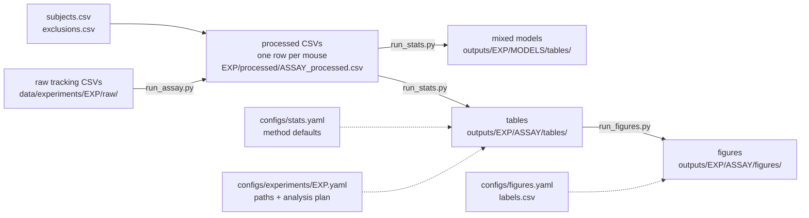

# Pipeline guide

How data moves from raw tracking files to the statistics and figures in a paper, what
each step does, where it is configured, and how to check the results.
Quick commands: `scripts/cheatsheet.txt`. Every change that affects results: `docs/changelog.md`.

---

## 1. The big picture



Three commands, always in this order, always with the experiment config:

| Step | Command | Reads | Writes |
|---|---|---|---|
| 1. Ingest | `run_assay.py --assay <instance>` | raw files, subjects.csv | `processed/<INSTANCE>_processed.csv` |
| 2. Stats | `run_stats.py` | processed files, exclusions, plan | `outputs/<EXP>/<ASSAY>/tables/`, `outputs/<EXP>/MODELS/` |
| 3. Figures | `run_figures.py --assays ...` | processed files, stats tables | `outputs/<EXP>/<ASSAY>/figures/` |

Design rules the code enforces:

- **One row = one mouse** in every processed file. Repeated measures (VIT phases, OFT sessions) are
  either derived into per-mouse columns or stacked explicitly in a mixed model.
- **Configuration, not code, defines an analysis.** Adding an endpoint or a model is a config change.
- **Fail loudly.** Typos in configs, duplicated keys, missing files, undeclared primary endpoints or
  test order stop the run with a message saying what to fix. Nothing falls back silently.
- **Every table is traceable**: `run_id` column -> provenance file -> commit, configs and input data.

---

## 2. Where things live

```
configs/
  stats.yaml                    method defaults shared by all experiments
  experiments/<EXP>.yaml        one per experiment: paths, assay instances, analysis plan
  figures.yaml                  figure style and manual figure specs
  labels.csv                    axis label and title per assay x endpoint
  schema_aliases.yaml           maps vendor column headers to canonical names
data/experiments/<EXP>/
  raw/<instance>/               tracking exports (EthoVision etc.)
  metadata/subjects.csv         mouse_id, group, sex, cage, box ... (one row per mouse)
  metadata/exclusions.csv       which mouse is excluded from what, and why
  processed/<INSTANCE>_processed.csv
outputs/<EXP>/                  = paths.out_dir of the experiment
  <ASSAY>/tables/  <ASSAY>/figures/  <ASSAY>/logs/      pipeline results
  MODELS/tables/   MODELS/logs/                         linear / mixed models
  exploratory/                                          output of scripts/exploratory/ (not validated)
src/behaviour_stat_pipeline/
  assays/        ingestion per assay type (registry.py: VIT, OFT, SPL, EPM, NOR, LM, MISC)
  common/        schema normalisation, exclusions, QC
  stats/         statistics; stats/endpoints/ one module per analysis; stats/r/ optional R backend
  figures/       box plots, scatter, Kaplan-Meier
scripts/         command-line entry points (run_assay, run_stats, run_figures, helpers)
  exploratory/   one-off analyses outside the pipeline (not validated); legacy/ superseded scripts
tests/           smoke tests, reference tests against R, config tests
```

---

## 3. The three configuration layers

| Layer | File | Holds | Changes when |
|---|---|---|---|
| Methods | `configs/stats.yaml` | correction methods, ANOVA type, posthoc pairs, diagnostic thresholds, R location | the lab changes how it analyses data (rare; goes in the changelog) |
| Experiment | `configs/experiments/<EXP>.yaml` | paths, assay instances, **analysis plan** | per experiment |
| Presentation | `configs/figures.yaml`, `configs/labels.csv` | sizes, fonts, sex markers, axis labels, manual figures (nothing group-specific) | figures change |

The experiment's `analysis:` block is merged over `stats.yaml` before anything runs. Mappings merge;
lists (endpoints, models, specs) in the experiment **replace** the shared ones. Both `run_stats.py`
and `run_figures.py` use the same merged config.

### 3.1 Experiment config, field by field

```yaml
experiment: {id: EXP-2026-002}

groups:                              # the ONLY place for group order, labels and colours
  order: [control, ifs]              # every group value in subjects.csv must be listed
  labels: {ifs: IFS}                 # optional; default: capitalised value
  colors: {control: darkorchid, ifs: darkorange}   # optional; missing ones get distinct
                                     # colour-blind-safe colours (Okabe-Ito)

paths:
  metadata_subjects: data/experiments/EXP-2026-002/metadata/subjects.csv
  exclusions:        data/experiments/EXP-2026-002/metadata/exclusions.csv
  processed_dir:     data/experiments/EXP-2026-002/processed
  out_dir:           outputs/EXP-2026-002   # results: <out_dir>/<ASSAY>/{tables,figures,logs}

assay_instances:                     # every test that was run, by the name used everywhere else
  OFT2:
    assay_type: OFT                  # which ingestion + which endpoint lists apply
    order: 5                         # position in the test battery (1 = first test)
    day: 1                           # optional: e.g. days relative to manipulation onset
    raw_path: data/experiments/EXP-2026-002/raw/OFT2
    session: post
  LM:
    assay_type: LM
    trial_duration_s: 300            # nominal trial length (censoring of latencies)
  NOR:
    assay_type: NOR
    objects: [flask, lego_tower]     # the two object types, as named in the export columns
    fam_pattern: "*FAM*_output_summary.csv"
    test_pattern: "*TEST*_output_summary.csv"
    min_explore_s: 20                # advisory low-exploration flag
  VIT:
    assay_type: VIT
    filename_tokens:                 # token in the file name -> value (exactly one must match)
      timepoint: {first_min: Before, second_min: After}
      phase: {hand: hand, standing: standing}

analysis:                            # THE ANALYSIS PLAN - see section 5
  assays: [vit, nor, oft1, oft2, oft3, oft4, lm, misc]
  primary_endpoints: {...}
  primary_one_sample: {nulls: {...}}
  diagnostics: {endpoints: {...}}
  secondary_two_way_anova: {endpoints: {...}}
  time_to_event: {endpoints: {...}}
  linear_models: {models: [...]}
  correlations: {specs: [...]}

analysis_frozen_at: <commit sha>     # optional, see section 5.3
```

**Assay instances vs assay types.** `OFT1`–`OFT4` are four runs of the same test type `OFT`.
Endpoint lists can be written once for the type (`oft:`) and apply to every instance; an
instance-specific list (`oft2:`) takes precedence.

**Groups.** `groups.order` sets the order of groups in every figure, the level positions used in
posthoc `selected_pairs`, and the direction of linear-model contrasts. Two groups with the same
colour, a group in the data that is not declared, or group settings anywhere else (`figures.yaml`,
`factor_orders.group`) are errors.

**Test order.** The pipeline never infers chronology from names. Anything that depends on order
(stacked sessions in a mixed model, a baseline) requires `order` for the instances involved; a
baseline must come before the sessions it adjusts. `day` is optional and gives models a numeric
time variable.

---

## 4. Step 1 – Ingestion (`run_assay.py`)

For one assay instance:

1. Finds raw files under `raw_path` matching `pattern` (default `*_output_summary.csv`), plus
   behaviour-classifier reports (`classifier_pattern`) where present.
2. Normalises column headers with `configs/schema_aliases.yaml` (vendor exports vary:
   `"total distance moved"` -> `total_distance_moved`). Suspicious or duplicate columns are logged.
3. Matches raw IDs to `subjects.csv` and attaches group, sex, cage etc.
4. Runs QC (unique mouse per session, subject coverage) – fails on duplicates.
5. Derives per-mouse endpoints (e.g. NOR discrimination indices, VIT `delta_*`/`did__*` contrasts,
   MISC sums/ratios defined in `stats.yaml -> misc.derived_metrics`).
6. Writes `processed/<INSTANCE>_processed.csv` and a summary log.

Assay-specific settings come from `assay_instances.<NAME>` in the experiment config, not from
the code:

- **NOR**: `objects` (required; any two object names, any number of copies per object),
  `fam_pattern` / `test_pattern` (which files are the familiarisation and test sessions),
  `min_explore_s`. The familiar object is the one with non-zero values in FAM; in TEST exactly
  one copy of each object may carry data.
- **VIT**: `filename_tokens` maps parts of the file name to timepoint and phase; a file name that
  matches none or several tokens is an error.
- **All**: `classifier_pattern` for behaviour-classifier reports.

Processed files are never edited by the statistics; exclusions are applied at analysis time.

**Sucrose splash test (SPL)** is ingested with the same parameters as OFT: same EthoVision summary
and classifier report, same column aliases (`schema_aliases.yaml -> spl` points to the OFT mapping),
same QC. To add it to an experiment:

```yaml
assay_instances:
  SPL:
    assay_type: SPL
    raw_path: data/experiments/<EXP>/raw/spl
    classifier_pattern: "*_Report_summary.csv"
    order: 6
analysis:
  assays: [..., spl]
  secondary_two_way_anova:
    endpoints:
      spl: [classifier__grooming_time, classifier__grooming_count, total_distance_moved]
```

Grooming is the main SPL outcome. If a *latency to first groom* is exported, analyse it under
`time_to_event` (mice that never groom are censored), not in the ANOVA.

---

## 5. The analysis plan

### 5.1 What to declare

| Key | Meaning |
|---|---|
| `assays` | instances analysed when `run_stats.py` is called without `--assays` |
| `primary_one_sample.nulls` | endpoints tested against a fixed value (e.g. NOR DI vs 0) |
| `secondary_two_way_anova.endpoints` | endpoints for group x sex ANOVA + posthoc |
| `time_to_event.endpoints` | latencies where the event may not happen (censoring) |
| `linear_models.models` | mixed models / ANCOVA (section 6.6) |
| `correlations.specs` | x–y pairs (always exploratory) |
| `diagnostics.endpoints` | distribution, variance and outlier checks (descriptive) |
| `primary_endpoints` | which of the above test the experiment's hypotheses |

### 5.2 Primary vs exploratory

Every output table has `endpoint_role` = `primary` or `exploratory`. Multiple-comparison corrections
across endpoints are computed **within role**: the few primary endpoints form their own family, so
they are not penalised by dozens of exploratory endpoints, and exploratory results are clearly
labelled. With no `primary_endpoints` declared, everything is exploratory.

```yaml
analysis:
  primary_endpoints:
    nor: [di_explore]                         # by assay instance or type
    oft_post_sessions: [total_distance_moved] # by linear-model name
```

A primary endpoint that is not actually analysed for that assay/model is a config error.

### 5.3 Freezing the plan

To show the plan was fixed before the results were seen:

1. Finish the `analysis:` block, commit it.
2. Put that commit's sha in the experiment config: `analysis_frozen_at: <sha>` (top level).
3. Every run compares the current `analysis:` block with the frozen one and records the result in
   the provenance file (`analysis_plan.unchanged`). A change prints a warning; with
   `--require-clean` it stops the run.

If a plan is decided after looking at data, say so in the paper; freezing records *when* it was fixed,
it cannot make a post-hoc choice pre-specified.

---

## 6. Step 2 – Statistics (`run_stats.py`)

Runs, per assay instance and in this order, every analysis the plan enables; then the linear models
(which can span several instances). Exclusions are applied per assay x endpoint first.

### 6.1 Exclusions (`metadata/exclusions.csv`)

| column | meaning |
|---|---|
| `mouse_id` | mouse to exclude |
| `assay` | instance (`OFT2`), or `*` for all |
| `endpoint` | endpoint name, or `*` for all |
| `exclude_from` | `primary`, `sensitivity` or `all` |
| `reason` | required free text |

A mouse excluded from one endpoint still counts for the others. Excluded IDs and reasons are
written into every affected table (`n_excluded`, `excluded_mouse_ids`, `exclusion_reasons`).
A configured exclusion file that does not exist is an error.

**Sensitivity analysis.** The primary analysis drops rows marked `primary` or `all`; the
sensitivity analysis drops rows marked `sensitivity` or `all`. When the two sets differ for an
assay, one-sample, ANOVA, posthoc and time-to-event are run again and written next to the primary
tables as `<table>_sensitivity.csv` (column `analysis_scope`). Typical use: a post-hoc exclusion
(e.g. aberrant behaviour) marked `exclude_from: primary`, so results are reported without and with
the animal.

### 6.2 Analyses and their outputs

| Analysis | Question | Test | Output (`outputs/<EXP>/<ASSAY>/tables/`) | Correction |
|---|---|---|---|---|
| One-sample | does a group differ from a fixed value (e.g. DI ≠ 0)? | t-test (+ Wilcoxon), 95% CI | `<ASSAY>_primary_one_sample.csv` | Holm across groups per endpoint |
| Two-way ANOVA | group, sex, group x sex | OLS, Type II (config) | `<ASSAY>_secondary_two_way_anova.csv` | Holm across endpoints per term, within role |
| Posthoc | which cells differ? | cell means with pooled MSE (Prism-style) | `<ASSAY>_secondary_posthoc_cellmeans.csv` | Šidák across the selected pairs |
| Time to event | do groups differ in how fast an event happens? | Cox (HR, 95% CI, LR tests), log-rank stratified by sex, KM medians | `<ASSAY>_time_to_event.csv`, `_summary.csv` | Holm across endpoints per term, within role |
| Correlations | are x and y related? | Spearman/Pearson (or OLS with robust SE) | `<ASSAY>_correlations.csv` | BH-FDR within spec |
| Diagnostics | distributions, unequal variances, outliers | Brown–Forsythe, variance ratio, MAD-z, ROUT-like | `<ASSAY>_endpoint_diagnostics_by_*.csv`, `_flagged_points_*` | – (flags only, never excludes) |
| Linear models | repeated sessions, covariates, unequal variances | nlme lme/gls, Type III | `outputs/<EXP>/MODELS/tables/<model>_*.csv` | Holm across endpoints per term, within role; Holm across contrasts |

### 6.3 Designs: factors and levels

ANOVA, posthoc and time-to-event take **one or two factors with any number of levels**
(`secondary_two_way_anova.factors`, `time_to_event.factors`; default `[group, sex]`). For a
single-sex study set them to `[group]` in the experiment's plan; for three groups nothing changes.

- ANOVA: one-way or two-way; Type II or III.
- Posthoc: cells can be named by level (`{group: ifs, sex: male}`) or by position in the level
  order (`{group: 1, sex: 1}`). Instead of listing pairs, `comparisons` generates them:

  ```yaml
  posthoc:
    comparisons:
      - {factor: group, by: [sex]}   # every pair of groups within each sex; with one factor: by: []
  ```
  Šidák is applied over all comparisons of an endpoint.
- Time to event: a factor with more than two levels gets an omnibus likelihood-ratio test
  (term = factor, df = levels − 1) plus one hazard-ratio row per level against the reference
  (first level alphabetically), term `group[ifs vs control]`. Box plots and KM figures then show
  the omnibus result as text rather than a two-group bracket.

### 6.4 Which analysis for which endpoint

- **Continuous, one value per mouse** (distances, times): two-way ANOVA.
- **Index tested against chance** (NOR DI): one-sample test, *and* the ANOVA for group differences.
  "IFS is not different from 0 but control is" is not a group difference – use the ANOVA.
- **Latency where the event may never happen** (enter an alley, first immobility): time to event.
  A missing latency in a recorded animal is censored at that animal's recording length
  (`time_to_event.duration_col`, else `trial_duration_s`); animals without a recording are excluded.
  Never put such latencies in the ANOVA – that drops the slowest animals (config error).
- **The same test repeated over sessions** (OFT1–4): a linear mixed model (6.6).
- **Skewed, positive data**: add a `log` transform in the linear model, check `shapiro_p`.

### 6.5 Reading the tables

Common columns: `endpoint`, `term`, `p_value` (raw), `p_adj` (corrected), `significance_label`
(from `p_adj`), `endpoint_role`, `n`, exclusion columns, `run_id`. Hazard ratio > 1 = the event
happens sooner. Linear-model estimates are on the transformed scale given in `transform`
(log: differences are log ratios; `exp(estimate)` is the ratio).

### 6.6 Linear and mixed models (optional R backend)

One model spec covers one design and many endpoints:

```yaml
linear_models:
  models:
    - name: oft_post_sessions
      assays: [oft2, oft3, oft4]     # stacked, in the declared battery order
      stack_as: session              # factor naming the stacked instances
      baseline: oft1                 # same endpoint in OFT1 as per-mouse covariate (ANCOVA)
      endpoints: [total_distance_moved, time_in_center]
      fixed: "group * sex * session + baseline"   # or "group * day" with numeric days
      random: "~ 1 | mouse_id"       # null -> no random effects (plain linear model / ANCOVA)
      variance_by: [group]           # unequal residual variance per group; [] -> equal
      transforms: {time_in_center: log}
      contrasts:
        - {factor: group, by: [session]}   # control vs IFS at each session
```

Rules enforced: stacked sessions need a random effect; a baseline cannot also be a stacked session;
sessions follow `assay_instances.<NAME>.order`. Tests: Type III F-tests (sum-to-zero contrasts,
covariates centred), nlme denominator df. `model_info` reports the variance ratios, a
likelihood-ratio test of unequal vs equal variances (keep `variance_by` only if it helps, and say
so), and a residual normality test.

R is only needed here: install R (nlme ships with it). Rscript is found via
`linear_models.rscript`, the `BSP_RSCRIPT` environment variable, `PATH` or the standard install
folder. A model only runs when all its instances are in the same `run_stats.py` call.

---

## 7. Step 3 – Figures (`run_figures.py`)

- **Box plots** for every ANOVA endpoint (automatic), annotated from the ANOVA/one-sample tables.
- **Scatter plots** for every correlation spec (automatic).
- **Kaplan–Meier curves** for every time-to-event endpoint: pooled (with HR, Cox and log-rank p,
  correction named) and by sex; censored mice marked `|`.
- **Manual figures** from `figures.yaml -> specs` (e.g. NOR familiar vs novel).

Run stats first: figures read the tables for their annotations. Labels come from `labels.csv`.
PNG and PDF are written; use the PDFs for the paper.

---

## 8. Provenance and reproducibility

Each run writes `<ASSAY>_provenance.json` (and `MODELS/logs/<model>_provenance.json`) with:
git commit and any uncommitted files, SHA-256 of every config and input file, package versions
(and R/nlme versions for models), the frozen-plan check, session order. `run_id` in every table is a
hash of all of that (except time), so the same code + configs + data always give the same `run_id`.

**For results you will report**

1. Commit everything (`git status` clean).
2. `python scripts/run_stats.py --config configs/stats.yaml --experiment-config <exp> --require-clean`
3. `python scripts/run_figures.py ...`
4. Report the commit sha; keep the provenance files with the results.

---

## 9. Checking that the statistics are right

`tests/reference/` compares every statistic with independent reference values computed in R
(`generate_reference.R`, base R + `survival` + `nlme`) on fixed datasets: one-sample t/Wilcoxon,
Type II/III ANOVA, posthoc, Pearson/Spearman, OLS with HC3, p-value corrections, Cox/log-rank/KM,
and the mixed-model backend (against statsmodels MixedLM and WLS). Run `python -m pytest` after any
change to the statistics. Tests that need R are skipped without it.

---

## 10. New experiment checklist

1. Create the folders (cheatsheet section 8) and copy the raw exports.
2. `subjects.csv`: one row per mouse – `mouse_id`, `group`, `sex`, and cage/box if available.
3. Copy an existing `configs/experiments/<EXP>.yaml`; edit paths and `assay_instances`
   (with `order`, optional `day`, `trial_duration_s` for latency tests).
4. Ingest every instance (`run_assay.py`); check the processed files and summaries.
5. Write the `analysis:` block, including `primary_endpoints`; commit; set `analysis_frozen_at`.
6. `exclusions.csv` with a reason for each row (decide criteria before looking at results).
7. Run stats with `--require-clean`, then figures.
8. Read `model_info`, diagnostics and KM figures before interpreting p-values.

---

## 11. When something stops

| Message | Meaning / fix |
|---|---|
| `Duplicate key ... line N` | a YAML key appears twice; the second would silently win – delete one |
| `unknown keys [...]` | typo or unsupported option in a config section |
| `primary_endpoints.X: [...] are not analysed` | primary endpoint not in any analysis list for X (typo?) |
| `the order of the tests is not declared` | set `assay_instances.<NAME>.order` for the listed instances |
| `baseline ... does not come before` | the baseline's `order` is after a stacked session |
| `observed latencies exceed the recording length` | wrong `trial_duration_s` / `duration_col` |
| `also listed in secondary_two_way_anova.endpoints` | a censored latency cannot also go through ANOVA |
| `linear_models needs R` | install R or set `linear_models.rscript` / `BSP_RSCRIPT` |
| `Exclusion file configured but not found` | path in the experiment config is wrong |
| `Run this from the repository root` | `cd` to the repository first; config paths are relative to it |
| `paths [out_tables, ...] are replaced by paths.out_dir` | old experiment config: use `out_dir` |
| `unknown top-level keys` | a misspelt or removed section in stats.yaml / the analysis block |
| `groups.order is not set` / `group_order has moved` | add the `groups:` block to the experiment config |
| `groups [...] are in the data but not in groups.order` | a group value in subjects.csv is not declared (typo?) |
| `several groups share a colour` | give the groups different colours in `groups.colors` |
| `--require-clean set and uncommitted changes` | commit (or stash) before a reportable run |
| `analysis plan changed since it was frozen` | the `analysis:` block differs from `analysis_frozen_at`; revert, or re-freeze and document why |
